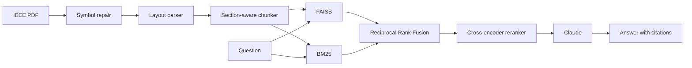

# RAG-Based IEEE Paper Assistant

Upload an IEEE research paper, ask questions about it, and get streamed answers that cite the exact passages they came from.

**[Try the live demo](https://huggingface.co/spaces/TianxinXie123/IEEE-Paper-Assistant)**. The Space sleeps when idle, so the first visit may take a minute or two.

Generic RAG pipelines struggle with IEEE PDFs: two-column layouts break the reading order, magazine page decorations get mistaken for figures, and publisher math fonts extract "ε = 8" as "2 ¼ 8". This project fixes those problems in the parser and measures each change with a retrieval benchmark.

## Highlights

- **Hybrid retrieval:** FAISS embeddings and a from-scratch Okapi BM25 are merged with Reciprocal Rank Fusion, then reranked by a cross-encoder. Recall@3 rises from 57.7% (dense only) to 87.4%.
- **A parser that works across IEEE templates:** it was generalized from one paper to 11 papers in 7 templates. Recall@3 rises from 78.4% to 87.4% overall, and from 25% to 87.5% on two magazine papers.
- **Symbol repair with Claude vision:** unreliable characters are detected by their font, each distinct glyph is recognized once, and the result is cached.
- **A repeatable benchmark:** `evaluate.py` scores every retrieval configuration on 129 labeled questions, with no LLM calls.
- **Grounded answers:** Claude answers from the retrieved passages only and cites them as `[Source N]`. Clearly off-topic questions are rejected before any LLM call.
- **A public demo with bounded costs:** a Flask API and JavaScript page run in a Docker Space, with a separate paper for each visitor and request limits per visitor and overall.

## How it works



1. **Special characters:** publishers' math fonts often map glyphs to the wrong Unicode text (the sample paper's "ε = 8, δ = 10⁻⁵" extracts as "2 ¼ 8, d ¼ 10-5"). Characters drawn with fonts known to be mapped unreliably (Symbol-encoded and publisher symbol fonts; TeX/MathType fonts are trusted) are detected by font, deduplicated per glyph, rendered with a red box around them and identified once with Claude vision. The resulting map is cached in `data/cache/symbols/` and applied to the whole paper. Superscripts are written as `^x` or `^(...)`, and accents drawn before their letter are recomposed ("Hübler"). At most 30 glyphs are recognized per paper. Without `ANTHROPIC_API_KEY` this step is skipped.
2. **Parsing:** text blocks are sorted by their (x, y) coordinates to reconstruct the reading order of multi-column layouts. Running headers and footers (lines repeated in the page margins), page numbers, copyright notices and download watermarks are removed.
3. **Figures and tables:** text inside figures and tables is kept out of the body text. Each caption (plus the table cells, as Markdown) becomes its own chunk, labeled like `[Table I, page 4]`.
4. **Chunking:** body text is split at section headings, detected from font size and numbering, then into sentence-aligned chunks that fit the embedding model's 256-token limit (counted with its own tokenizer), with whole-sentence overlap within a section. The references section is kept out of the index.
5. **Indexing:** chunks are converted into 384-dimensional vectors and stored in a FAISS index. Indexes are cached per PDF in `data/cache/<pdf-name>_<hash>/` as `index.faiss` and `chunks.pkl`. The hash covers the PDF content and the embedding model, so switching papers never reuses a stale index.
6. **Retrieval:** the top 3 chunks are selected by hybrid search and the reranker. When a retrieved paragraph mentions "Fig. 2" or "Table I", that figure or table is added to the context automatically.
7. **Answering:** Claude writes the answer from those chunks with `[Source N]` citations, streaming it as it is generated. Follow-up questions ("And on Imagenette?") use the last 3 turns: the question is first rewritten into a standalone one for retrieval. Questions whose best match is below a cosine similarity of 0.15 are not sent to the LLM; start a question with `!` to ask anyway.

Two tasks skip retrieval and send the full paper to the LLM: a structured summary, and reviewer-style suggestions.

## Tech stack

| Area | Tools |
|---|---|
| Language | Python 3.10+ |
| PDF parsing | PyMuPDF |
| Embeddings | Sentence-Transformers (`all-MiniLM-L6-v2`) |
| Vector search | FAISS |
| Keyword search | Okapi BM25, implemented in [`src/bm25.py`](src/bm25.py) |
| Reranking | `cross-encoder/ms-marco-MiniLM-L-6-v2` |
| LLM | Anthropic Claude API (default `claude-haiku-5-5`), with Google Gemini as an option |
| Web | Flask, JavaScript |
| Deployment | Docker, Hugging Face Spaces |
| Tests | pytest |

## Getting started

Install the dependencies:

```bash
pip install -r requirements.txt
```

On Windows you can double-click `setup.bat` instead, which creates a virtual environment. `run.bat` then starts the command line and `web.bat` starts the web interface. `python check_setup.py` verifies the packages, the embedding model and your API keys.

Set the API key for the LLM you want to use (Windows PowerShell):

```powershell
$env:ANTHROPIC_API_KEY = "your-key"    # for Claude (default)
$env:GEMINI_API_KEY = "your-key"       # for Gemini
```

Put the papers you want to use in `data/papers/` (for example, PDFs downloaded through your university's IEEE Xplore access). They are not included in this repository because they are copyrighted, and PDFs in `data/` are ignored by git, so your papers are never committed. Each question set in `eval/` names the paper it was written for (its `pdf` field) and the paper's title and venue, so the same PDFs can be downloaded again.

## Usage

### Command line

```bash
python main.py                                    # choose a paper from data/papers/, answered by Claude (claude-haiku-5-5)
python main.py --pdf data/papers/my_paper.pdf     # a specific paper; its index is built and cached automatically
python main.py --pdf data/papers/my_paper.pdf --rebuild  # force re-indexing
python main.py --model claude-opus-5-5            # a stronger (more expensive) Claude model
python main.py --provider gemini                  # answer with Gemini (gemini-2.5-flash)
python main.py -k 5                               # retrieve 5 chunks instead of 3
python main.py --retrieval dense                  # embeddings only (also: bm25, hybrid = default)
python main.py --no-rerank                        # skip the cross-encoder reranker (faster, less accurate)
python list_models.py                             # list the models your API keys can use
```

Anything you type is answered from the most relevant chunks, except for these commands:

| Command | What it does |
|---|---|
| `/summary` | Structured summary of the whole paper |
| `/suggest` | Strengths, weaknesses and concrete suggestions for the work |
| `/reset` | Forget the conversation so far |
| `/help` | List the commands |
| `exit` | Quit |

### Web interface

```bash
python server.py                                  # then open http://localhost:8000
python server.py --model claude-opus-5-5 --port 8080
```

The page in `docs/` introduces the assistant, takes a PDF by drag and drop or file picker, and has a chat box with the same features as the command line: streamed answers, follow-up questions, Summarize and Review buttons (`/summary`, `/suggest`), `/reset` and `/help`. Each answer lists the passages it was built from, and clicking a `[Source N]` citation opens that passage. Uploaded papers are saved in `data/uploads/` (ignored by git) and indexed with the same cache as `main.py`.

`server.py` is a small Flask API around the same pipeline:

| Endpoint | Request | Response |
|---|---|---|
| `GET /api/health` | None | Backend status and the loaded paper |
| `POST /api/upload` | Multipart `file` field | Saves and indexes the PDF |
| `POST /api/ask` | `{"question", "task": null \| "summary" \| "suggest", "history"}` | Answer as NDJSON events |

By default it listens on 127.0.0.1 only. Only pages served from this computer, from `https://tianxinxie123.github.io` or from the Hugging Face Space it runs in may call it (add more with the `RAG_ALLOWED_ORIGINS` env var). Each visitor (browser) has a paper of their own: the page sends a random id in the `X-Visitor-Id` header, and the 20 most recently used papers are kept in memory.

### GitHub Pages (optional)

`docs/` is a static site, so it can be published with Settings > Pages > Deploy from a branch > `main`, `/docs`. GitHub Pages cannot run Python, so the published page still needs `server.py` running on the visitor's computer. It looks for it at `http://localhost:8000` (the address can be changed by clicking the connection status). Chrome and Edge ask once for permission to let the site reach this computer.

## Deployment on Hugging Face Spaces

The [`Dockerfile`](Dockerfile) runs the web interface as a Hugging Face Docker Space (cpu-basic: 2 vCPU, 16 GB; Docker Spaces need a PRO account). The embedding and reranker models are downloaded into the image at build time.

It runs `python server.py --public`, which listens on all interfaces and applies these limits (`PUBLIC_LIMITS` in `server.py`), so strangers cannot run up the API bill:

| Scope | Uploads | Questions |
|---|---|---|
| Each visitor, per hour | 5 | 20 |
| All visitors together, per day | 50 | 200 |

Set a monthly spending limit in the Anthropic Console as well.

To deploy your own copy:

```bash
hf auth login
hf repos create TianxinXie123/IEEE-Paper-Assistant --type space --space-sdk docker --flavor cpu-basic --public
```

In the Space, open Settings > Variables and secrets and add the secret `ANTHROPIC_API_KEY`. Then upload the files:

```bash
hf upload TianxinXie123/IEEE-Paper-Assistant space/README.md README.md --repo-type space
python -c "from huggingface_hub import HfApi; HfApi().upload_folder(repo_id='TianxinXie123/IEEE-Paper-Assistant', repo_type='space', folder_path='.', allow_patterns=['Dockerfile', '.dockerignore', 'requirements.txt', 'server.py', 'main.py', 'src/*.py', 'docs/*'])"
```

`space/README.md` becomes the Space's README (its YAML header configures the Space). The app files are uploaded from Python because on Windows `hf upload` expands `--include "src/*.py"` into file names and fails. Every upload rebuilds the Space.

On the hosted demo, uploaded files stay in the Space's temporary storage and are deleted when it restarts. The passages used for an answer, or the whole paper for Summarize and Review, are sent to the Anthropic API.

## Evaluation

```bash
python evaluate.py                                # retrieval quality on every question set in eval/ (no API calls)
python evaluate.py --show-misses                  # also print what was retrieved for each miss
```

Each question lists evidence phrases copied from the paper, and a question is answered at rank r if the r-th retrieved chunk contains one of them. The script reports Recall@1/3/5, MRR, the effect of figure linking, and the score distribution of answerable and unanswerable questions that was used to choose the relevance threshold.

**Test set:** 11 IEEE papers covering 7 templates (Transactions, Letters, two magazines, IEEE Access, an Open Journal and a conference paper), with 111 answerable and 18 unanswerable questions.

### Generalizing the parser

Results with the default configuration (hybrid + rerank), before and after making the parser generalize beyond the first paper:

| Test set | R@1 | R@3 | R@5 | MRR@5 |
|---|---:|---:|---:|---:|
| First paper only (31 questions) | 74.2% | 100.0% | 100.0% | 0.860 |
| All 11 papers, before | 57.7% | 78.4% | 82.0% | 0.677 |
| All 11 papers, after | **64.0%** | **87.4%** | **92.8%** | **0.756** |

Two fixes closed most of the gap:

- **Lost magazine text:** magazine layouts merged page decorations with figure drawings, so about 58% of their body text was dropped as "figure text". A figure region may no longer contain a paragraph of body-size text, and Recall@3 on two magazine papers (16 questions) rose from 25% to 87.5%.
- **Page furniture:** running headers, page numbers, copyright notices and download watermarks are now removed.

### Comparing retrieval configurations

All configurations on all 11 papers:

| Configuration | R@1 | R@3 | R@5 | R@3 + figures | MRR@5 | ms/query |
|---|---:|---:|---:|---:|---:|---:|
| Dense | 32.4% | 57.7% | 70.3% | 58.6% | 0.463 | 11 |
| BM25 | 57.7% | 73.9% | 87.4% | 73.9% | 0.676 | 12 |
| Hybrid | 47.7% | 72.1% | 80.2% | 72.1% | 0.601 | 11 |
| Dense + rerank | 63.1% | 83.8% | 89.2% | 83.8% | 0.737 | 385 |
| **Hybrid + rerank (default)** | **64.0%** | **87.4%** | **92.8%** | **87.4%** | **0.756** | 382 |

Fusion alone does not beat BM25 on this test set. Most of the gain comes from the reranker, which adds roughly 370 ms per query. Latency was measured on a local machine and varies with its load.

### History on the first paper

| Change | Recall@3 |
|---|---:|
| Starting point (dense) | 70.0% |
| Token-aware chunking and hybrid search | 93.3% |
| Section headings as chunk boundaries | 93.5% |
| Cross-encoder reranker, now with one-topic chunks | 100% |

Adding the section path to every chunk ("contextual chunk header") did not help, so it is off.

### Caveats

- The questions were written while reading the papers, so they share wording with them, which favors keyword search.
- The same questions were used to tune the system and to report these results, so there is no held-out set.
- The relevance threshold is conservative: at 0.15 it rejects none of the 111 answerable questions, but only 3 of the 18 unanswerable ones. The rest go to the LLM, which is instructed to say it doesn't know.

## Tests

```bash
python -m pytest                                  # unit tests (no API key needed)
```

## Project layout

```text
main.py            command-line app
server.py          Flask API and static web page
evaluate.py        retrieval benchmark
Dockerfile         image for the Hugging Face Space
docs/              web page (HTML, CSS, JavaScript)
eval/              labeled question sets, one per paper
tests/             unit tests
src/
  pipeline.py      indexing pipeline shared by the apps
  symbols.py       special-character detection and repair
  pdf_loader.py    PDF parsing for IEEE layouts
  figures.py       figures, tables and the links to them
  chunker.py       token-aware, section-aware chunking
  embedder.py      Sentence-Transformers embeddings
  vector_store.py  FAISS index and on-disk cache
  bm25.py          Okapi BM25 keyword search
  retriever.py     dense, BM25 and hybrid retrieval with reranking
  llm_engine.py    Claude and Gemini backends
  evaluation.py    retrieval metrics
```
